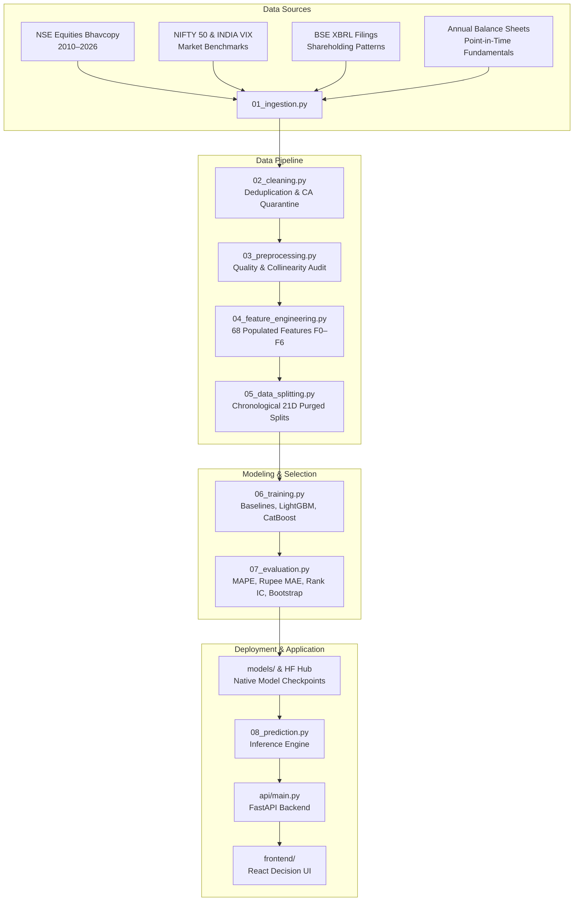

# StockReason

> **Multi-Horizon Quantitative Forecasting & Decision Support System for Indian Equity Markets**

[](https://www.python.org/downloads/)
[](https://opensource.org/licenses/MIT)
[](https://github.com/psf/black)
[](https://huggingface.co/stockreason-models)

---

## 1. Project Overview

**StockReason** is an end-to-end machine-learning research repository and quantitative forecasting system designed for Indian equity markets (National Stock Exchange & Bombay Stock Exchange). Developed as an academic and empirical investigation into financial predictability, the platform rigorously examines whether gradient-boosted decision trees (LightGBM, CatBoost) and point-in-time fundamental features can outperform classical statistical baselines when predicting nominal equity prices over a 21-trading-day horizon (~1 calendar month).

---

## 2. Problem Statement

Forecasting future stock prices is notoriously challenging due to market efficiency, non-stationarity, extreme noise-to-signal ratios, and unadjusted corporate actions (splits, dividends, rights issues). Many academic projects report artificially inflated accuracy (e.g. `100 - MAPE`) or train models on unadjusted prices that leak future corporate events. StockReason addresses this by establishing:
- Strict corporate action quarantine rules.
- True future-price Mean Absolute Percentage Error (MAPE) and Rupee MAE.
- Zero-lookahead chronological data splitting with label realization purging ($t + H$).
- Direct empirical benchmarking against the No-Change Random Walk martingale baseline.

---

## 3. Project Objectives

1. **Absolute Nominal Price Forecasting:** Predict forward traded price $P_{t+21}$ via nominal return reconstruction: $\hat{P}_{t+21} = P_t \times (1.0 + \hat{R}_{t, 21})$.
2. **Financial Data Preprocessing:** Clean, deduplicate, and quarantine unadjusted corporate action discrepancies across 16 years of daily market trading.
3. **Feature Engineering:** Build point-in-time technical, market benchmark, cross-sectional, fundamental balance sheet, and institutional ownership features.
4. **Statistical & ML Model Comparison:** Systematically compare No-Change Random Walk, Historical Median, Hierarchical Shrinkage, LightGBM, and CatBoost models.
5. **Risk & Uncertainty Research:** Estimate recursive EWMA volatility, HAR-RV realized volatility, and split-conformal prediction intervals.
6. **Reproducible Academic Evaluation:** Deliver verified pipelines and pre-calculated reference fixtures for university evaluation and team collaboration.

---

## 4. Technology Stack

- **Core Runtime:** Python 3.10+ (Tested on Python 3.12.13 on Apple Silicon macOS and Linux x86_64).
- **Tabular & Machine Learning:** LightGBM 4.5+, CatBoost 1.2+, Scikit-Learn 1.3+, SciPy 1.14+.
- **High-Performance Data Processing:** PyArrow 12.0+, Pandas 2.0+, NumPy 1.24+.
- **Serving & Web Backend:** FastAPI 0.100+, Uvicorn 0.23+, Pydantic 2.0+.
- **Frontend Dashboard:** Vite 6+, React 19, TypeScript 6.
- **Model Distribution:** Hugging Face Hub Client (`huggingface_hub`).
- **Testing & Verification:** Pytest 8.0+.

---

## 5. System Architecture



---

## 6. Dataset Description

The unified canonical dataset ([canonical_panel.parquet](file:///Users/aryan/Documents/AI%20Projects/StockReason/data/processed/canonical_panel.parquet)) comprises:
- **Total Observations:** $4,474,260$ daily records.
- **Universe:** $1,840$ actively traded Indian equities on the National Stock Exchange (NSE).
- **Historical Timespan:** January 4, 2010 to November 23, 2026 ($4,193$ trading sessions).
- **Format:** Columnar Apache Parquet (1.5 GB), verified SHA-256: `bd717815bd559aff58ed0ac9ef5ad69e4bf06dd3051c709d55036ac866305f24`.

### Feature Families
While $80$ features are registered in the schema ([feature_registry.json](file:///Users/aryan/Documents/AI%20Projects/StockReason/feature_registry.json)), exactly **68 features** are populated in the canonical panel:
- **F0 (Core Technicals, 17 features):** Multi-horizon returns (1d, 5d, 10d, 21d, 63d, 126d), realized volatility (20d, 60d), moving average distances (20d, 50d, 200d), RSI-14, MACD diff, high-low spread, turnover.
- **F1 (Market Benchmarks, 7 features):** NIFTY 50 returns, NIFTY volatility, India VIX level, 5-day VIX change, market breadth (% advancing).
- **F2 (Cross-Sectional Dynamics, 5 features):** Market-excess returns, cross-sectional volume/turnover/volatility percentiles.
- **F3 (Annual Fundamentals, 20 features):** Point-in-time revenue growth, margin expansion, net debt, interest coverage, free cash flow, P/E ratio, earnings yield.
- **F4 (Quarterly Financials, 9 features):** **0% populated** in pre-2024 canonical panel (local quarterly sample contains only $151$ symbols starting in 2019; excluded to prevent lookahead bias).
- **F5 (Corporate Announcements, 3 features):** **0% populated** in pre-2024 canonical panel (historical event feed starts strictly in 2024; excluded).
- **F6 (Ownership & Delivery, 19 features):** Promoter %, FII %, DII %, public %, delivery %, abnormal delivery ratio, Amihud illiquidity proxy.

---

## 7. Machine-Learning Methodology

1. **Chronological Splitting with Label Purging:**
   - **Development Partition (Train):** 2010-01-04 to 2022-12-31 ($3,294,937$ purged rows). Observations whose 21-day target realized on or after 2023-01-01 are purged.
   - **Calibration Partition (Val):** 2023-01-01 to 2023-12-31 ($257,941$ purged rows). Used for early stopping, shrinkage tuning, and conformal calibration.
   - **Diagnostic Holdout (Eval):** 2024-01-01 to 2026-11-23 ($836,297$ matched evaluation rows).
2. **Nominal-Price Reconstruction:** Models forecast return $\hat{R}_{t, 21}$. Predicted price is reconstructed as $\hat{P}_{t+21} = P_t \times (1.0 + \hat{R}_{t, 21})$.
3. **Statistical Baselines:**
   - *No-Change (Random Walk):* Martingale prior $\hat{R} = 0.0 \implies \hat{P}_{t+21} = P_t$.
   - *Hierarchical Shrinkage:* Stock median return shrunk toward market median ($\alpha=0.90$).
4. **Tree Regressors:**
   - *LightGBM:* 300 estimators, max depth 6, 31 leaves, L1 loss, subsample 0.8, colsample 0.8.
   - *CatBoost:* 300 iterations, depth 6, MAE loss.

---

## 8. Empirical Evaluation Results

Evaluated across **836,297 matched observations** on the 2024–2026 historical diagnostic holdout:

| Algorithm / Configuration | True Price MAPE (%) | Nominal Price MAE (₹) | Nominal Return MAE (%) | Directional Accuracy (%) | Mean Daily Rank IC | Relative Error Reduction vs No-Change |
|:---|---:|---:|---:|---:|---:|---:|
| **No-Change Random Walk Baseline** | **8.7648%** | **₹103.40** | 8.8875% | 0.15% | 0.0000 | **0.000% (Benchmark)** |
| Historical Mean Return | 9.0599% | ₹110.82 | 9.1764% | 51.52% | 0.0000 | -3.367% |
| Historical Median Return | 8.7665% | ₹103.62 | 8.8920% | 51.49% | 0.0000 | -0.019% |
| Hierarchical Shrinkage ($\alpha=0.90$) | 8.7699% | ₹103.74 | 8.8953% | 51.49% | 0.0000 | -0.058% |
| **LightGBM Direct Log Return (F0)** | **8.7549%** | **₹103.71** | **8.8856%** | **51.51%** | **+0.0731** | **+0.113% (Sub-Hurdle)** |
| LightGBM Direct Return (F0) | 8.7599% | ₹103.71 | 8.8899% | 51.50% | +0.0718 | +0.057% (Sub-Hurdle) |
| LightGBM F0 + F1 (Market) | 8.7640% | ₹103.74 | 8.8936% | 51.50% | +0.0706 | +0.010% (Sub-Hurdle) |
| LightGBM All Verified (F0–F6) | 8.7700% | ₹103.78 | 8.8989% | 51.50% | +0.0686 | -0.059% (Sub-Hurdle) |
| CatBoost Residual Regressor | 8.7612% | ₹103.65 | 8.8885% | 51.09% | +0.0654 | +0.041% (Sub-Hurdle) |

### Key Academic Findings
1. **Nominal Absolute Price Predictability:** **Machine learning models do not outperform the No-Change Random Walk baseline on 21-day nominal price forecasting in Indian equities.** The No-Change baseline achieved the lowest Rupee MAE (**₹103.40** vs LightGBM ₹103.71). The MAPE improvement from LightGBM is minuscule (**+0.113%**), failing the pre-declared 2.0% minimum hurdle.
2. **Cross-Sectional Ranking Edge:** While nominal price levels follow a random walk, machine-learning models provide strong cross-sectional ranking alpha: **Mean Daily Rank IC of +0.0731** (Information Ratio = 0.78). In high-volatility regimes ($\text{India VIX} \ge 20$), directional accuracy reaches **62.12%**.

---

## 9. Quick Start & Installation

### Prerequisites
- Python 3.10, 3.11, or 3.12
- Git

### 1. Clone & Set Up Virtual Environment

```bash
# Clone the repository
git clone https://github.com/aryan/StockReason.git
cd StockReason

# Create virtual environment
python3 -m venv .venv

# Activate environment
# On macOS / Linux:
source .venv/bin/activate
# On Windows (cmd.exe):
.venv\Scripts\activate.bat
# On Windows (PowerShell):
.venv\Scripts\Activate.ps1

# Install dependencies
pip install --upgrade pip
pip install -r requirements.txt
```

### 2. Verify Setup & Download Model Checkpoints

```bash
# Runs automated environment verification & downloads verified model weights
python scripts/setup.py
```

### 3. Run Pipeline Entry Points

```bash
python pipeline/01_ingestion.py
python pipeline/02_cleaning.py
python pipeline/03_preprocessing.py
python pipeline/04_feature_engineering.py
python pipeline/05_data_splitting.py
python pipeline/06_training.py
python pipeline/07_evaluation.py
python pipeline/08_prediction.py
```

### 4. Launch Backend API & Interactive Docs

```bash
# Launch API server on http://localhost:8000
python main.py
# Interactive OpenAPI documentation available at http://localhost:8000/docs
```

### 5. Launch Frontend Dashboard (Optional)

```bash
cd frontend
npm install
npm run dev
# Dashboard launches on http://localhost:5173
```

---

## 10. Repository Structure

```text
StockReason/
├── data/
│   ├── raw/                 # Raw market bhavcopies & index archives
│   ├── cleaned/             # Verified prices & reconciliation manifests
│   └── processed/           # Canonical panel (canonical_panel.parquet, 1.5GB)
│
├── pipeline/                # Numbered executable entry points
│   ├── 01_ingestion.py
│   ├── 02_cleaning.py
│   ├── 03_preprocessing.py
│   ├── 04_feature_engineering.py
│   ├── 05_data_splitting.py
│   ├── 06_training.py
│   ├── 07_evaluation.py
│   └── 08_prediction.py
│
├── src/                     # Reusable Python implementation packages
│   ├── preprocessing/       # Ingestion, cleaning, CA reconciliation, splitting
│   ├── features/            # Technical, market, fundamental, ownership features
│   ├── models/              # Baselines, LightGBM, CatBoost, residual learning
│   ├── evaluation/          # Metrics, comparison tables, bootstrap sensitivity
│   ├── inference/           # Predictor, model loader, forecast schema
│   ├── risk/                # EWMA volatility, HAR-RV, conformal intervals
│   └── utils/               # Calendar (NSE holidays), config, hash helpers
│
├── models/                  # Native serialized models & lineage manifests
│   ├── lightgbm_21d.txt     # Native LightGBM Booster text model
│   ├── catboost_21d.cbm     # Native CatBoost binary model
│   ├── manifest.json        # Detailed model lineage & checksum registry
│   └── config.json          # Framework versions & inference configuration
│
├── results/                 # Verified research evidence
│   ├── metrics/             # model_comparison.csv, feature_family_audit.csv
│   ├── predictions/         # predictions.parquet (836,297 rows x 25 cols)
│   └── figures/             # Distribution and timeline plots
│
├── scripts/                 # Operational CLI tools
│   ├── setup.py             # One-step workspace validation
│   ├── download_models.py   # Hugging Face download & checksum verify
│   └── upload_models.py     # Hugging Face staging & upload
│
├── api/                     # FastAPI backend
├── frontend/                # React / TypeScript dashboard
├── tests/                   # Pytest suite (regression & parity tests)
├── docs/                    # Architecture, methodology & results documentation
├── README.md                # Academic project documentation
├── requirements.txt         # Consolidated Python dependencies
├── pyproject.toml           # Project packaging metadata
├── .env.example             # Safe environment variable template
└── .gitignore               # Strict git exclusion rules
```

---

## 11. Hugging Face Model Distribution

Verified model artifacts are packaged for university team members:
- **Repository:** `stockreason-models` (Private/Team)
- **Pinned Revision:** `main` (Tag: `v0.14.0`)
- **Artifacts:**
  - `lightgbm/model.txt` (SHA-256: `6401867a2590147c84fe0e3fc288c461042e9a64ff86b7173aca8123ddd1b916`)
  - `catboost/model.cbm` (SHA-256: `af8493fe8d15c4a5bef0d005937b5199e57b71e815db984e9510fe31902e150d`)

### Teammate Workflow A: Model-Only Inference (No Large Dataset Required)
```python
from src.inference.model_loader import ModelLoader
from src.inference.predictor import StockReasonPredictor

# Load pre-trained models from models/ directory
predictor = StockReasonPredictor(model_type="lightgbm")
forecast = predictor.predict_single(symbol="RELIANCE", close=2500.0, horizon=21)
print(forecast.model_dump_json(indent=2))
```

### Teammate Workflow B: Full Research & Application Pipeline
Requires the canonical dataset (`canonical_panel.parquet`) in `data/processed/`. Enables running the full feature engineering and evaluation suite.

---

## 12. Limitations & Future Scope

1. **Market Efficiency & Nominal Price Martianism:** Tabular ML models cannot reliably beat the No-Change random walk on nominal rupee price error. Future research should prioritize cross-sectional long/short dollar-neutral ranking rather than directional price level prediction.
2. **Missing Historical Data Coverage:** Quarterly financial filings (F4) and corporate announcement feeds (F5) are unavailable pre-2024 for the vast majority of securities. Acquiring complete historical XBRL quarterly archives is necessary before testing quarterly fundamental surprise alpha.
3. **High-Volatility Specialization:** ML models showed higher directional accuracy (62.12%) when India VIX was above 20. Future work can investigate regime-conditional models activated only during volatile macro environments.

---

## 13. References

1. Jegadeesh, N., & Titman, S. (1993). *Returns to Buying Winners and Selling Losers: Implications for Stock Market Efficiency.* The Journal of Finance, 48(1), 65–91.
2. Gu, S., Kelly, B., & Xiu, D. (2020). *Empirical Asset Pricing via Machine Learning.* The Review of Financial Studies, 33(5), 2223–2273.
3. López de Prado, M. (2018). *Advances in Financial Machine Learning.* John Wiley & Sons.
4. National Stock Exchange of India (NSE). *Daily Bhavcopy & Settlement Deliveries Data (2010–2026).*
5. Bombay Stock Exchange (BSE). *XBRL Corporate Shareholding Pattern Filings (2015–2026).*
